# LPM-10C home UI: open firmware patch for the FNIRSI LPM-10C cable tester

A patch for the FNIRSI LPM-10C network cable tester (transmitter unit, firmware
V2.0.7). It replaces the home screen with a clean scrolling list, adds a
**Link status** tool that checks a network port from the physical link up to
DNS and IPv6, and **fixes a flash wear bug** in the vendor firmware. It also
contains the reverse-engineering notes, tools and emulator that made it possible.

<p>
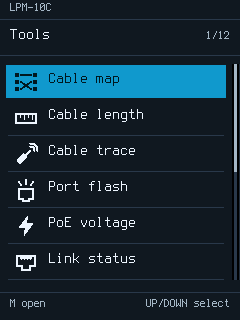
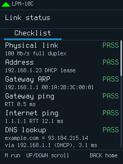
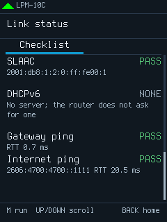
</p>

> [!WARNING]
> **Disclaimer: use at your own risk.** This is unofficial firmware,
> unaffiliated with and unsupported by FNIRSI. Installing modified firmware
> can leave your tester unusable ("bricked"), lose its settings or calibration,
> or void its warranty. **I am not responsible for any damage to your device,
> and by using this code, patches or releases you accept all of that risk
> yourself.** The software is provided "as is", without warranty of any kind
> (see [LICENSE](LICENSE)).

## Contents

- [What it changes](#what-it-changes)
- [Screenshots](#screenshots)
- [The flash wear bug](#the-flash-wear-bug)
- [Hardware](#hardware)
- [Installing](#installing)
- [Building from source](#building-from-source)
- [Development tools](#development-tools)
- [Repository layout](#repository-layout)
- [Acknowledgements and licenses](#acknowledgements-and-licenses)

## What it changes

All other vendor tools (cable map, length, trace, port flash, PoE, link speed,
IP scan, settings) are the vendor's own code. They are reached from the
new home screen, and (since the next release) drawn in its theme.

**Home screen**
- One scrolling list of the ten tools, each with an icon and a plain name,
  instead of the vendor's three pages of 2×2 tiles. UP/DOWN select, M opens.
- English only, drawn with the Terminus bitmap font (6×12 and 8×16), which
  is crisper on the 240×320 panel. The Chinese pictures left on English
  screens (the reset warning title and the company name in About) are
  removed.
- Link speed gets its own speedometer icon.
- The battery icon no longer flashes while you scroll.

**Link status** (new, in the slot of the vendor QC test). Plug the cable into
the **top-left port**, marked by the vendor's green arrow, and press M. Each
step shows PASS, WARN, FAIL, SKIP or NONE with details:

| Step | What it checks |
| --- | --- |
| Physical link | Link up, with the negotiated speed and duplex |
| Address | DHCPv4 lease (WARN if the server offers but never acknowledges) |
| Gateway ARP | The gateway answers ARP; shows its MAC |
| Gateway ping | ICMP echo to the gateway, with round-trip time |
| Internet ping | 1.1.1.1, then 8.8.8.8 |
| DNS lookup | `example.com` via the DHCP DNS server, falling back to 1.1.1.1; shows the resolved address and the server used |
| Router (IPv6) | Router advertisement: router link-local address, prefix, lifetime, flags |
| SLAAC | A stateless address from the advertised /64, after duplicate address detection |
| DHCPv6 | A DHCPv6 address: SOLICIT, ADVERTISE, REQUEST, REPLY, or rapid commit |
| Gateway ping (IPv6) | ICMPv6 echo to the router |
| Internet ping (IPv6) | Cloudflare (2606:4700:4700::1111), then Google |

The list scrolls with UP/DOWN and follows the check in progress. The tester
answers ARP and IPv6 neighbour solicitations while it runs, so routers can
reach it.

**Switch port** (unreleased; the second Link status tab, RIGHT to show it).
Press M to listen for what the switch says about its port, for up to 32 s:

| Row | Shows |
| --- | --- |
| Switch | Name and model, from LLDP or CDP |
| Port | Port ID and description |
| VLAN | Port (native) VLAN, voice VLAN, and any 802.1Q tags seen on the wire |
| Management | The switch's management address |
| PoE | The class and power the switch allocates |
| 802.1X | Whether the port asks for authentication (an EAP request answering an EAPOL-Start) |

The tester announces itself as an LLDP-MED endpoint first, so LLDP-MED
switches answer at once instead of at their next 30 s interval.

**Ping monitor** (unreleased; replaces the vendor PING screen). Press M to
start and M to stop: one ping a second to the gateway, 1.1.1.1, 8.8.8.8 or an
address of your own (LEFT/RIGHT), with the latest round trip, loss, a graph of
the last 190 round trips, and min, average, max and variation. Hold M to type
the address: UP/DOWN change a digit, LEFT/RIGHT move, M uses it and BACK
cancels. Each run gets its own address by DHCP; it stops with NO LINK if the
cable is pulled, and keeps the tester on while it runs.

**Theme for the vendor tools** (unreleased). Every vendor screen now uses the
home screen's colours and Terminus font. Tool titles use the home list names.
Layouts and behaviour are unchanged.

**Fixes**
- The flash wear bug, below.

**Space**
- 139 KB of vendor pictures and code that nothing reaches any more (the old
  grid menu, Chinese glyphs and pictures) are cleared for reuse, leaving
  about 117 KB free for future tools. `scripts/check_dead_code.py` checks that
  nothing references a region before it is reused.

The full list per release is in [CHANGELOG.md](CHANGELOG.md).

## Screenshots

These are rendered by running the patched firmware code in an emulator
(`scripts/preview_menu.py`, `scripts/preview_link_status.py`) against a
simulated network. The display and fonts are the tester's own, pixel for pixel.

| Home | Home, scrolled | Link status: IPv4 | Link status: IPv6 router |
| --- | --- | --- | --- |
|  | 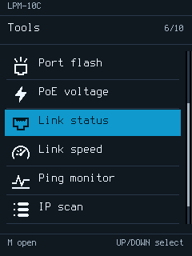 |  | 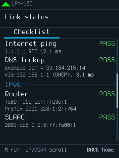 |

| Link status: SLAAC | Link status: DHCPv6 lease | No Internet access |
| --- | --- | --- |
|  | 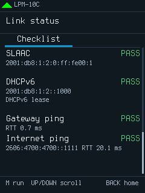 | 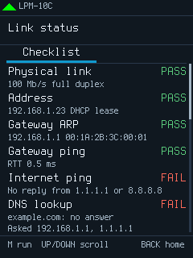 |

| Ping monitor | Ping target address | Switch port: LLDP | Switch port: end | Cable map, themed |
| --- | --- | --- | --- | --- |
| 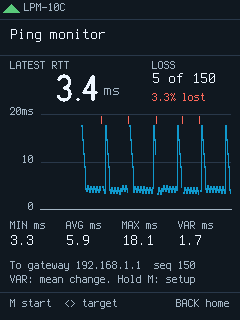 | 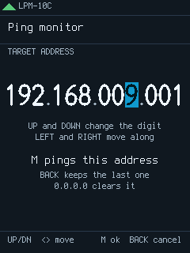 | 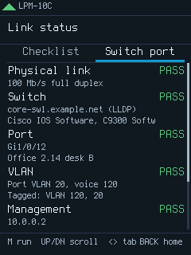 | 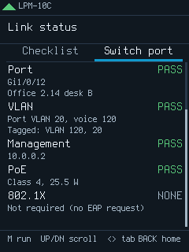 | 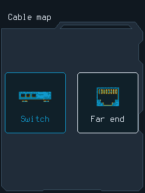 |

The green arrow in the top-left corner of the Link status screens points to the
port to use.

## The flash wear bug

The vendor firmware **erases and reprograms its settings page in flash at every
power-off**, including Auto Off, whether or not any setting changed. The routine
(`0x080104B8`) erases the `Cust_Info` page at `0x0807F800`, programs 204 bytes
and verifies them.

The N32G45x flash is rated for 100,000 erase cycles per page. At ten power-offs
a day, the vendor firmware uses up that page's rated life in about 27 years.
Every erase is also a moment when a power loss can corrupt the page, which
holds all settings and per-conductor values the cable tests use, and there
is no reason to take that risk when nothing changed.

The patch (`src/firmware_patch/cust_info.c`) compares the settings in RAM with
the copy in flash, using the same comparison the vendor uses to verify its
write, and calls the vendor writer only when they differ. Seven of the eight
call sites are redirected. The eighth, restore defaults, always changes the
record and is left alone. The flash routines themselves are untouched.

Verified on a tester through the UART log: a power-off with no changes no longer
logs `APP_Home_Cust_Info_Storage`, and changing a setting brings it back. See
[the analysis](docs/lpm-10c-bootloader-analysis.md#flash-wear).

## Hardware

The LPM-10C is a two-part cable tester: the **transmitter (TX)**, with the
screen, buttons and Ethernet ports, and a remote **receiver (RX)**. This
project changes only the transmitter firmware.

| Part | Details |
| --- | --- |
| MCU | Nations **N32G455** (Cortex-M4F, 144 MHz, 512 KB flash, 144 KB SRAM), marking blacked out on the board; identified over SWD from `DBG_ID`. Flash read protection is level 1 |
| Display | 240×320 TFT on the external memory bus (`0x60000000`), RGB565 |
| Ethernet packet path | DAVICOM **DM9051** SPI 10/100 controller with its own PHY. Used by Ping, IP scan and Link status, via the top-left port |
| Gigabit PHY | Motorcomm **YT8521SC** (10/100/1000), used by Link speed; powered down otherwise |
| PoE | onsemi **NCP1095** powered-device controller with two MB6S bridge rectifiers (PoE class/voltage tool) |
| Cable tests | Three HC4051 multiplexers, an HC4066 switch, an HC125 buffer and a 358 op-amp for wiremap, length and trace |
| Clock | 8 MHz crystal (MCU); 25 MHz crystals for each Ethernet chip |
| OS | FreeRTOS |
| Board | Silkscreen `10_TX_V2.3_20260310` |

**Debug header.** A labelled six-pin header next to the MCU:
`SWCLK GND SWDIO 3V3 RX TX`.
- The UART on TX runs at **1,000,000 baud, 8N1**. It prints a boot log and
  module messages such as `LENG: Link speed 1000M`.
- SWD works for reading SRAM. Flash is read-protected (level 1).

> [!CAUTION]
> Never let a tool "unlock", "mass erase" or "recover" this MCU. Going from read
> protection level 1 to level 0 **erases the whole flash, including the factory
> calibration**, which no update file restores.

**Update path.** The bootloader at `0x08000000` (36 KB) is never touched by
updates.
- Hold **M** while powering on and the tester appears as a USB drive named
  `BOOT`.
- Copy an update file named exactly `LPM-10C_TX_V2.0.7_260907.bin`. The tester
  installs it and restarts by itself.
- The file maps to flash at `file offset + 0x08009000`.
- It must not exceed **434,176 bytes**. Larger files install only in part, and
  the tester crashes at boot until a good file is installed.
- Copy from **Windows**. FNIRSI warns not to update from macOS, and a copy from
  macOS was ignored in testing.

Details: [board inspection](docs/lpm-10c-board-inspection.md),
[hardware capabilities](docs/lpm-10c-hardware-capabilities.md),
[bootloader and patches](docs/lpm-10c-bootloader-analysis.md),
[network stack](docs/lpm-10c-network-analysis.md).

## Installing

Releases contain **no FNIRSI firmware**. Each one contains a patch file
(`lpm-10c-home-ui-vX.Y.Z.patch.json`), `lpm_patch.py`, `LICENSE` and `NOTICE`.
The patch holds only the bytes this project wrote, never a byte of FNIRSI's
image, so it is useless without your own copy of the official update. The patch rebuilds the
released image from your own copy of the official update, and refuses to run
unless both the input and the result match the expected SHA-256.

1. Download the official **LPM-10C V2.0.7** update from FNIRSI:
   <https://www.fnirsi.com.cn/uploads/file1/20261010/d68467f735b832bc57860df7f230ada41791625743186.zip>
   (SHA-256 `6dfea6eef1f8ec5c4630b63690d3730fe6f2a76a9a4b094008a871de3d28c746`).
   It holds both the LPM-10A and the LPM-10C firmware; the tool picks the
   LPM-10C transmitter image. Keep the zip: it is also how you go back.
2. From the [latest release](../../releases/latest), download the
   `.patch.json` and `lpm_patch.py`.
3. Run (Python 3.8 or later, standard library only):
   ```sh
   python3 lpm_patch.py apply d68467f735b832bc57860df7f230ada41791625743186.zip lpm-10c-home-ui-vX.Y.Z.patch.json
   ```
   This writes `LPM-10C_TX_V2.0.7_260907.bin`. Do not rename it.
4. On **Windows**: turn the tester off, hold **M** and power it on. Copy the file
   to the `BOOT` drive and wait for the tester to restart.
5. The tester restarts into the new home screen. Settings are kept: they live
   in a flash page the update does not touch.

**Going back.** Install the unmodified `LPM-10C_TX_V2.0.7_260907.bin` the same
way. It is in `LPM-10C.zip` inside the FNIRSI download, or
`python3 lpm_patch.py extract <zip> --out .` writes it. The bootloader is not modified, so BOOT mode stays
available even if the application fails to start.

The release notes say whether the exact image was confirmed on a real tester
(`tested-builds.sha256`).

## Building from source

Requirements:
- LLVM clang 22 with the ARM target, and `ld.lld`
- Python 3.8 or later
- For the emulator and tests: unicorn 2.1.4 and capstone 5.0.7

Exact versions are in [CONTRIBUTING.md](CONTRIBUTING.md#setup).

```sh
brew install llvm@22 lld                                  # macOS; elsewhere use the LLVM release and set CLANG
python3 -m venv .venv && .venv/bin/pip install unicorn==2.1.4 capstone==5.0.7
curl -fLO https://www.fnirsi.com.cn/uploads/file1/20261010/d68467f735b832bc57860df7f230ada41791625743186.zip
python3 scripts/lpm_patch.py extract d68467f735b832bc57860df7f230ada41791625743186.zip  # checks the vendor image, puts it in firmware/extracted/
python3 scripts/build_patched_image.py home-ui            # -> firmware/patched/home-ui/LPM-10C_TX_V2.0.7_260907.bin
make test PYTHON=.venv/bin/python                         # C tests, script tests, 29 emulated network scenarios
```

With Homebrew LLVM 22.1.8 and lld 23.1.3 on macOS, the build produces
`efa2eff883b69a19…8035e6`, the image confirmed on a tester. The release notes
say whether a CI build matches a confirmed image.

**CI and releases.** `.github/workflows/ci.yml` runs the tests on every push and
pull request. `.github/workflows/release.yml` runs on `v*` tags: it builds,
tests, writes the patch and publishes a GitHub release with that version's
section of `CHANGELOG.md` and the build hashes. Both download the official
FNIRSI update from the URL above (the repository variable **`VENDOR_ZIP_URL`**
overrides it if FNIRSI moves the file), check the SHA-256 of the TX image inside
it, and never upload it.

## Development tools

All of these run on a computer, with no tester attached:

```sh
make test                      # host C tests (ASan/UBSan), script tests, generated-asset check
make screens                   # the portable UI (src/lpm_ui) with simulated data -> output/screens/
.venv/bin/python scripts/preview_menu.py --image firmware/patched/home-ui/LPM-10C_TX_V2.0.7_260907.bin --out output/home-ui
.venv/bin/python scripts/preview_link_status.py           # all 29 Link status scenarios -> output/link-status/
.venv/bin/python scripts/preview_link_status.py --only no-internet
python3 scripts/check_dead_code.py firmware/patched/home-ui/LPM-10C_TX_V2.0.7_260907.bin
python3 scripts/gen_subset_font.py                         # cut Terminus to the characters the patch draws
python3 scripts/inspect_firmware.py firmware/extracted/LPM-10C/LPM-10C_V2.0.7/LPM-10C_TX_V2.0.7_260907.bin
python3 scripts/inspect_network.py
python3 scripts/inspect_boot_interface.py
```

- **Firmware emulator.** `preview_menu.py` and `preview_link_status.py` run the
  patched image on a Cortex-M4 emulator (unicorn). The vendor drawing and
  network code runs unmodified.
  - The LCD bus and the DM9051 are modelled. The DM9051 model is attached to a
    simulated network with a DHCP server, router, DNS server, DHCPv6 server
    and Internet hosts.
  - The 29 scenarios cover the failure paths a real network rarely shows:
    no DHCP ACK, a silent gateway, CNAME answers, an RA lifetime of 0, a
    duplicate address, DHCPv6 without rapid commit, IPv6-only and more.
  - The emulator starts from `tests/fixtures/sram-sanitized.bin`, which is not
    a device dump; see [its README](tests/fixtures/README.md).
- **Dead-code checker.** `check_dead_code.py` follows branches and pointers
  in the image to find the vendor code and data the patch has stranded, before
  that space is reused.
- **Portable UI.** `src/lpm_ui` is a freestanding C99 implementation of the
  whole [proposed interface](docs/lpm-10c-ui-and-feature-proposal.md), with a
  host simulator.

**Hardware helpers** (read-only; see
[board inspection](docs/lpm-10c-board-inspection.md) for wiring):

```sh
scripts/uart_log.py --baud 1000000                  # UART console via a USB serial adapter (receive only)
.venv/bin/python scripts/uart_log.py --port ftdi://ftdi:232h/1 --baud 1000000   # FT232H through pyftdi
.venv/bin/python scripts/uart_baud.py --seconds 20  # measure an unknown baud rate with FT232H bit-bang
scripts/swd_identify.py --probe jlink               # MCU model, memory sizes, read-protection level (OpenOCD 0.12)
python3 scripts/swd_sram_dump.py --probe ft232h     # 144 KB SRAM snapshot, core keeps running
```

None of them write to the tester. The UART port is opened receive-only, and a
test checks that the OpenOCD scripts never halt, reset, write or erase. Power
the tester from its battery while probing.

Captures are saved under `evidence/`, which git ignores. They contain your MAC
address, network settings and calibration, so do not commit them.

## Repository layout

| Path | Contents |
| --- | --- |
| `src/firmware_patch/` | The C code added to the vendor image: home screen, Link status, flash-wear fix, drawing helpers, font subset |
| `src/lpm_ui/`, `src/host/` | Portable UI module and its host simulator |
| `src/fonts/` | Terminus 4.49.1 BDF sources and license |
| `scripts/` | Patch builder, release patch tool, emulator previews, dead-code checker, inspection and hardware helpers |
| `tests/` | C tests, script and emulator tests, the sanitized SRAM fixture |
| `docs/` | [Reverse-engineering notes](docs/README.md) and screenshots |
| `.github/` | CI and release workflows |
| `firmware/`, `evidence/` | Local only (git-ignored): vendor files, builds and device captures |

## Acknowledgements and licenses

- **Code:** [GNU General Public License v3.0 or later](LICENSE), copyright
  2026 Daniel Bittencourt; see [NOTICE](NOTICE). You may use, study, share and
  modify it. Anyone who distributes it, or firmware containing it, must
  release the complete source of that firmware under the same license. The only
  additional permission covers combining it with the Terminus font data.
- **Font:** the patched screens use **Terminus Font** 4.49.1 by Dimitar Toshkov
  Zhekov, copyright (C) 2020, under the
  [SIL Open Font License 1.1](src/fonts/terminus-4.49.1/OFL.TXT). The generated
  subset in `src/firmware_patch/subset_font.c` stays under the OFL. "Terminus
  Font" is a Reserved Font Name of the original. Thanks to its author for a
  font that reads well on a small screen.
- **FNIRSI** makes the LPM-10C and owns its firmware, which is not
  redistributed here. This project is not affiliated with or endorsed by
  FNIRSI. Product names are their owners' trademarks.
- Built with [LLVM](https://llvm.org/), [Unicorn](https://www.unicorn-engine.org/),
  [Capstone](https://www.capstone-engine.org/) and
  [OpenOCD](https://openocd.org/).
