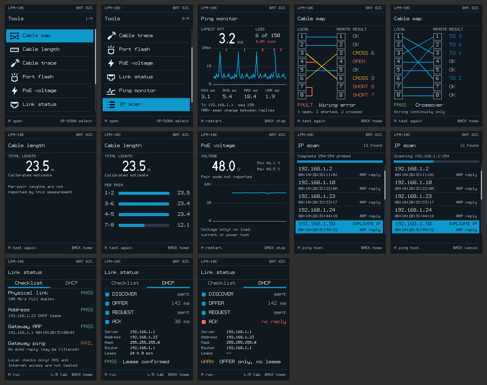

# LPM-10C replacement UI: implementation notes

Implements the first-priority items of the [UI and feature proposal](lpm-10c-ui-and-feature-proposal.md) as a portable module, `src/lpm_ui/`, with a host simulator and tests. Implemented 2026-10-19. **Nothing has run on a tester.** No firmware image was modified, built or flashed.

The home screen and Link status from this design were later built into the vendor firmware as a patch (`src/firmware_patch/`), which does run on the tester; see [bootloader and patches](lpm-10c-bootloader-analysis.md#home-screen-in-the-working-design-home-ui).

*Rendered by `make screens` at panel resolution. All values are simulated.*

## What is implemented

| Proposal item | Implementation |
| --- | --- |
| Direct vertical list home screen | Nine items in the proposed order, six 36 px rows, 24 px monochrome icons, inset highlight, `n/9` position count, scroll bar |
| Up/Down select, M enter, Back returns | Selection is remembered across tool screens and stock screens. Back on the home list is returned as `UNHANDLED`, so stock Back/power behaviour is preserved |
| Boundary behaviour | Stops at the ends by default. Optional wrap (`lpm_status.menu_wrap`) applies to fresh presses only; held keys never wrap |
| Accelerated repeat | Up/Down/Left/Right repeat after 450 ms, then 160 → 70 → 40 ms. M and Back never repeat, leaving long-press calibration/power actions alone |
| Ping | Latest RTT, loss count and %, min/avg/max and RTT variation; 120-probe strip plot with auto 1-2-5 scale, timeout markers and line gaps. Duplicate sequence numbers are rejected |
| Cable map | Eight local/remote pins, straight or crossed conductors, OPEN/SHORT n/CROSS n beside affected pins. Recognises standard and gigabit crossovers. Says "Wiring continuity only"; no category claim |
| Length | Large calibrated total in m or ft. Per-pair bars only when the firmware reports independent pair values |
| PoE | Large voltage, min/max, 0–60 V labelled trend. Pair mode is shown only if supplied. States that load, current and power are not tested |
| IP scan | IP-ordered IP/MAC list, gateway and duplicate-IP tags, progress, cancel, overflow notice; M pings the selected host and Back returns to the list |
| DHCP | DISCOVER → OFFER → REQUEST → ACK timeline with durations, server/address/mask/router/lease. An OFFER-only result is shown as **WARN: OFFER only, no lease**, never as a lease |
| Link health | Physical link → address → gateway ARP → gateway ping, each with PASS/FAIL/WARN words. A failed ping says replies may be filtered; DNS and Internet are explicitly not tested. (The firmware's Link status adds an Internet ping to 1.1.1.1 or 8.8.8.8 and a DNS lookup through the DHCP DNS server or 1.1.1.1, and IPv6 checks (router advertisement, SLAAC, DHCPv6, gateway and Internet ping) in a scrolling list; see docs/lpm-10c-bootloader-analysis.md) |
| Graphics | One pixel font in three sizes: 5×9 small/12 px, 7×11 body/16 px and 16×28 numerals/32 px. Units are always shown, decimals right-aligned, and every fault colour has a word. Icons and numerals are vector designs rasterised to exact size |

Cable trace, Port flash and Settings remain stock screens. The UI returns `OPEN_NATIVE` and the firmware calls `lpm_app_resume()` afterwards.

## Design properties relevant to the MCU

- **No framebuffer.** The firmware implements two primitives (`fill_rect` and opaque 1-bit `draw_mono`). Each widget paints its own background, so updates redraw in place.
- **Partial redraws.** A selection move writes about 21.7k pixels: two rows, glyph and icon overdraw, and the counter. That is 28% of a frame. A data update leaves the status bar, title and footer untouched; tests enforce these bounds.
- **Bounded memory.** `lpm_data` is 1,872 bytes, and the 120-sample ping ring is 960 bytes at 8 bytes/sample. `lpm_app` is 32 bytes. The module has no heap, statics or libc calls. Its only runtime dependency is `__aeabi_uldivmod`, the 64-bit division helper in the standard ARM compiler runtime.
- **Footprint.** `make arm-size` with clang 21, `thumbv7em-none-eabihf -mcpu=cortex-m4 -Os`, gives **19,486 bytes** of code and constants. Assets are 4.2 KB of that. This compares with 147,840 bytes of the four signal images. Linking and any shared helpers are not included; see the resource caveats in the proposal.

## Firmware integration contract

`src/lpm_ui/lpm_app.h` documents the contract. In outline:

1. Implement `lpm_display` on the LCD writes (`0x60000000`/`0x60020000` in the stock firmware), preserving RGB565.
2. Map physical keys to `lpm_key` and feed `lpm_repeater` from the key scan and millisecond tick.
3. Call `lpm_app_key()` and perform the returned action with the **existing** routines. The actions are `START`, `STOP`, `OPEN_NATIVE`, `CANCEL_SCAN`, `PING_HOST` and `UNHANDLED`. `PING_HOST` must stop any scan first because the static analysis shows shared packet globals. A `START` for ping with `ip == 0` means the firmware's default target.
4. Write results into `lpm_data` using `lpm_ping_add_*`, `lpm_poe_add`, `lpm_scan_add` and direct fields. Then call `lpm_app_data_changed()` or `lpm_app_status_changed()`, and `lpm_app_render()` from the UI loop.

IPv4 addresses are host-order `uint32_t` (`a.b.c.d` = `a<<24 | …`).

## What remains before a device build

These are the unresolved items in the proposal's implementation boundary. This work does not address them:

- Locate the stock key-event, test-state and result variables to feed `lpm_data`. Confirm button mapping before changing it.
- Verify the panel dimensions and controller. The 240×320 portrait layout is inferred from coordinate tables.
- Decide where code lives: reclaimed artwork space with all live references reconciled, or verified free flash. Also obtain a linker map that respects the update container.
- Determine bootloader image validation (the file carries no checksum or signature: [analysis](lpm-10c-bootloader-analysis.md)), a recovery method and a firmware/settings/calibration backup before any write. The board has a labelled SWD/UART header ([board inspection](lpm-10c-board-inspection.md)); flash read protection is level 1, so SWD cannot back up flash.
- Choose wrap or stop for the shipped list. The default is stop.

## Changing the artwork

Fonts are ASCII-art blocks and icons are stroke/polygon lists in `scripts/gen_ui_assets.py`. Run `make assets` and commit both generated files. `make test` fails if they are stale. Check the result with `make screens`.

## Validation performed

- `make test`: 24 tests (205 checks) under ASan/UBSan, all passing. They cover navigation and retained selection, wrap and repeat rules, redraw bounds, ping statistics, ring order, wiremap classification, scan ordering/duplicates/overflow, formatting, clipping, and the words shown on screen. Examples include the DHCP OFFER-only verdict and the absence of invented per-pair lengths. Every screen is also driven with extreme values and checked for out-of-bounds drawing.
- `make screens`: images inspected visually at 2× scale.
- `make arm-size`: freestanding Cortex-M4F compile with `-Wall -Wextra -Wpedantic -Wconversion -Werror`.
- Two defects were found and fixed during testing: the feet conversion was off by 10×, and an RTT near `UINT32_MAX` overflowed.
